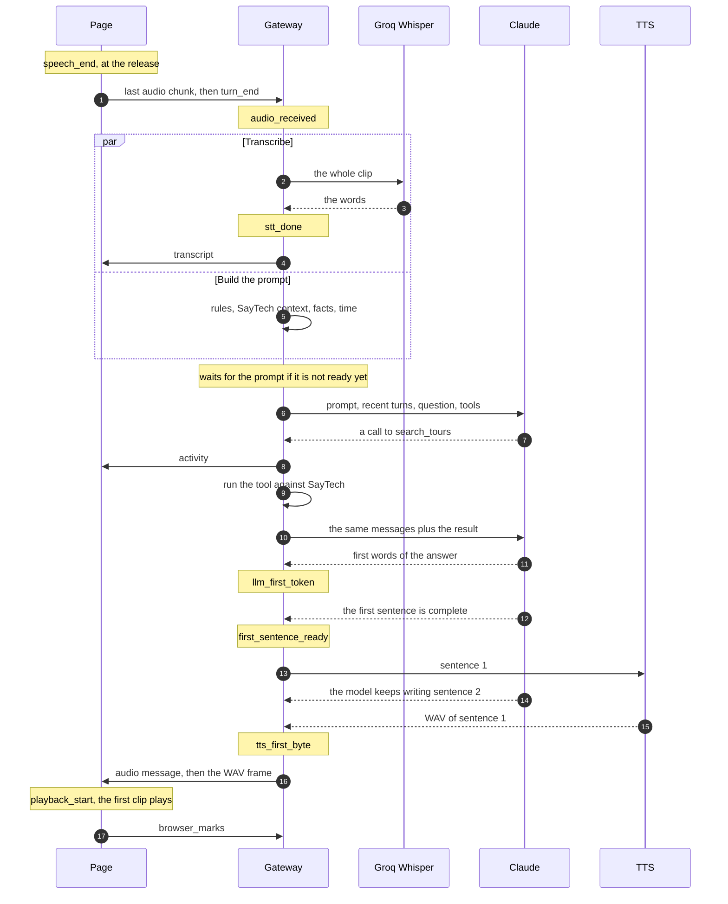

# 2. The API

The gateway has two kinds of API. Three small HTTP endpoints report on its health and
list the voices. Everything a conversation needs goes over one WebSocket at `/ws`: audio
up as binary frames, and control messages both ways as JSON text frames ([D-07](../DECISIONS.md#d-07-one-websocket-per-session), [D-47](../DECISIONS.md#d-47-the-voice-socket-binary-audio-json-control-schemas-on-both-sides)).
This chapter describes both in full, since the generated API docs can only show the first.

## Why `/docs` shows only three endpoints

`/docs` is FastAPI's built-in Swagger page, drawn from the OpenAPI schema at
`/openapi.json`. OpenAPI describes HTTP requests and their responses. It has no way to
describe a long-lived socket where either side may send a message at any time, so FastAPI
leaves WebSocket routes out of the schema. That leaves `/health`, `/ready` and `/voices`.
The socket's contract lives in two hand-written files instead:
[`messages.py`](../../gateway/src/sarjy_gateway/messages.py) on the gateway, as Pydantic
models, and [`protocol.ts`](../../frontend/src/lib/protocol.ts) on the page, as zod
schemas. Each side validates what it receives, and the two are changed together ([D-47](../DECISIONS.md#d-47-the-voice-socket-binary-audio-json-control-schemas-on-both-sides)).

## HTTP endpoints

| Endpoint | Answer | What it proves |
| --- | --- | --- |
| `GET /health` | 200 `{"status": "ok"}` | The process is up. Not `/healthz`, because Cloud Run reserves some paths ending in "z" ([D-41](../DECISIONS.md#d-41-health-checks-use-health-not-healthz)). |
| `GET /ready` | 200 `{"status": "ready", "reason": null}`, or 503 `{"status": "unavailable", "reason": "database unreachable: PoolTimeout"}` | The gateway can run `SELECT 1` on Postgres. Kept apart from `/health`, since voice works without the database ([D-64](../DECISIONS.md#d-64-postgres-18-on-the-smallest-cloud-sql-tier-reached-through-cloud-runs-socket)). |
| `GET /voices` | 200 `{"voices": ["af_heart", ...], "default": "af_heart"}`, or 503 `{"detail": "voices are unavailable right now"}` | The TTS service answered its own `GET /voices` ([D-49](../DECISIONS.md#d-49-selectable-voices-af_heart-by-default)). The page fills its voice picker from it. |

They are defined in [`health.py`](../../gateway/src/sarjy_gateway/health.py#L34) and
[`voices.py`](../../gateway/src/sarjy_gateway/voices.py#L13). Apart from FastAPI's own
`/docs`, `/redoc` and `/openapi.json`, everything else over HTTP is the built page, served
from `/` when `SARJY_FRONTEND_DIST` is set ([chapter 1](01-shape.md)).

## The identity cookie

Every HTTP response to a browser without a valid `sarjy_user` cookie sets one. Normally
that is the page load. The middleware is
[`identity_cookie`](../../gateway/src/sarjy_gateway/identity.py#L39):

- the value is a new user id, a UUIDv7, and nothing else;
- `HttpOnly`, so the page's JavaScript can't read it;
- `Secure`, unless `SARJY_COOKIE_SECURE=false` for plain-HTTP localhost;
- `SameSite=Lax`, and no `Domain`, so it goes only to the host that set it;
- `Max-Age` of 400 days, the longest browsers keep a cookie.

The cookie is not signed. The id is random enough to work like a session token: knowing it
is what makes a browser that user ([D-14](../DECISIONS.md#d-14-identity-is-an-anonymous-cookie), [D-66](../DECISIONS.md#d-66-identity-by-cookie-one-session-per-visit-turns-saved-after-they-are-spoken)). A missing or garbled cookie simply means a
new user.

The WebSocket needs it. A socket without a valid cookie is closed before it is accepted,
with code 1008 ([`voice.py` line 141](../../gateway/src/sarjy_gateway/voice.py#L141)),
which the server turns into an HTTP 403 at the handshake. So every conversation belongs to
a user, and the per-user limits below have something to count.

## The WebSocket at `/ws`

### What the page sends

| Frame | Fields | When | What the gateway does |
| --- | --- | --- | --- |
| binary | audio bytes | Every 250 ms while the orb listens, and the last piece at the release: WebM with Opus in Chrome, MP4 with AAC in Safari | Adds the chunk to the turn's audio ([`TurnAudio`](../../gateway/src/sarjy_gateway/turn_audio.py#L1)) |
| `turn_end` | `type` | The traveller let go and the page heard speech | Runs the turn |
| `turn_cancel` | `type` | The press was under 0.3 s or quieter than -45 dBFS ([D-55](../DECISIONS.md#d-55-the-browser-drops-presses-with-no-speech-before-they-reach-whisper)) | Drops the audio so far, answers nothing |
| `browser_marks` | `type`, `turn_id`, `speech_end`, `playback_start` | The turn's first clip started playing | Logs the turn's TTFA and stores both marks ([D-54](../DECISIONS.md#d-54-browser-marks-go-back-over-the-voice-socket-one-turn-at-a-time), [D-74](../DECISIONS.md#d-74-timings-in-postgres-for-every-turn-runs-as-json-lines-files)) |
| `set_voice` | `type`, `voice` | The traveller picked a voice | Checks TTS offers it, uses it from the next reply, saves it as the `voice` fact ([D-90](../DECISIONS.md#d-90-tour-links-beside-the-reply-a-remembered-voice-and-reconnecting)) |
| `replay` | `type`, `turn_id` | The traveller pressed play on an earlier answer | Speaks that stored reply again ([D-92](../DECISIONS.md#d-92-earlier-visits-sent-with-the-visit-replays-re-synthesised)) |
| `forget_me` | `type` | The traveller confirmed "Forget me" | Deletes the user's facts ([D-68](../DECISIONS.md#d-68-memory-panel-the-whole-list-over-the-socket-opened-with-the-page)) |

Every text frame is parsed as one
[`ClientMessage`](../../gateway/src/sarjy_gateway/messages.py#L58), a union told apart by
its `type`. Anything else, including a `turn_id` that isn't 32 hex characters or a
`playback_start` earlier than `speech_end`, is answered with `invalid_message`.

### What the gateway sends

| Message | Fields | When |
| --- | --- | --- |
| `memory` | `facts`: list of `{key, value}`, sorted by key | When the visit opens, and after every change: a fact saved or forgotten by the model, a voice picked, "Forget me". Always the full list ([D-68](../DECISIONS.md#d-68-memory-panel-the-whole-list-over-the-socket-opened-with-the-page)). |
| `history` | `visits`: list of `{started_at, turns: [{turn_id, transcript, reply}]}` | Once, right after the first `memory`: the last 3 earlier visits that had a question, newest first, each with its last 10 exchanges ([D-92](../DECISIONS.md#d-92-earlier-visits-sent-with-the-visit-replays-re-synthesised)). |
| `transcript` | `turn_id`, `text` | As soon as the speech is transcribed. The first message of a turn that was transcribed, and the first to carry its `turn_id`. |
| `activity` | `turn_id`, `text` | Once per tool call, just before the tools run, such as "Checking tomorrow's weather in Dubai"; none for a call whose arguments don't parse ([D-94](../DECISIONS.md#d-94-activity-status-from-fixed-templates-sent-before-each-tool-runs)). |
| `audio` | `turn_id`, `text` | Just before each binary WAV frame, with the words that frame speaks. A binary frame can't carry an id, so this message announces it. |
| binary | a WAV file | Right after its `audio` message: one sentence when streaming, the whole reply in the baseline. |
| `reply` | `turn_id`, `text`, `links`: list of `{name, url}` | The whole reply, with the pages of the tours it names ([D-90](../DECISIONS.md#d-90-tour-links-beside-the-reply-a-remembered-voice-and-reconnecting)). |
| `marks` | `turn_id`, `marks`: `{name: ms}` | The last message of a turn: the gateway's five marks, in ms since `audio_received` ([chapter 8](08-latency.md)). |
| `replay_done` | `turn_id` | After the last clip of a replay. |
| `error` | `code`, `turn_id` or null | In place of whatever was still to come. |

### One turn, in order

With sentence streaming, the default ([D-77](../DECISIONS.md#d-77-the-page-plays-sentence-clips-back-to-back-sentence-mode-by-default)), a turn looks like this on the wire:

```text
page → binary chunks … binary chunk, then turn_end
gw   → transcript
gw   → activity, one per tool call            (only if the model calls tools)
gw   → memory                                 (only if a fact was saved or forgotten)
gw   → audio + binary WAV, once per sentence  (the first may come before an activity)
gw   → reply                                  (after the last clip)
gw   → marks                                  (the end of the turn)
page → browser_marks                          (when the first clip starts playing)
```

Clips are produced by their own task while the model writes, so a sentence the model
writes before calling a tool can be spoken while the tool runs ([D-76](../DECISIONS.md#d-76-sentence-streaming-every-written-sentence-spoken-in-order-tools-first)). In the baseline
mode the order is `transcript`, any `activity`, `reply`, one `audio` with the whole reply,
then `marks`.

The page sends `browser_marks` as soon as the first clip plays, often before the gateway
has sent `marks`. The gateway reads the socket one message at a time, and it is busy
with the turn until `marks` is out and the turn is saved, so it reads `browser_marks` only
then. That order means the turn's row already exists when its browser marks are stored.

The diagram follows one turn with a tool call, from the release to the first clip.



## Errors

Every error is an `error` message with one of these codes
([`ErrorCode`](../../gateway/src/sarjy_gateway/messages.py#L66)). The socket stays open
after every one of them.

| Code | Sent when | `turn_id` |
| --- | --- | --- |
| `invalid_message` | A text frame isn't a valid client message | null |
| `no_audio` | `turn_end` arrived with no audio since the last turn | null |
| `turn_too_long` | The turn's audio went over `SARJY_MAX_TURN_AUDIO_BYTES` (1 MB) | null |
| `visit_limit` | The visit has already taken 100 turns | null |
| `too_many_turns` | The user or the IP is over its limit, for a turn or a replay | null for a turn, the replayed turn's id for a replay |
| `rate_limited` | Groq's speech to text answered 429, or the last chat model asked did: the only one, or the fallback | the turn's |
| `stt_failed` | Transcription failed: network, an HTTP error, an unknown audio container, no key | the turn's |
| `no_speech` | Whisper heard no words | the turn's |
| `llm_failed` | The chat model failed, after its fallback if there is one; the answer had no words; or the model kept calling tools | the turn's |
| `tts_failed` | TTS failed mid-turn or mid-replay; or `set_voice` couldn't list the voices | the turn's, or null for `set_voice` |
| `unknown_voice` | `set_voice` named a voice TTS doesn't offer | null |
| `forget_failed` | "Forget me" found the database unavailable | null |
| `replay_failed` | The turn to replay isn't one of this user's, or the database is unavailable | the replayed turn's |

An error ends a turn, but what was already sent stays sent. With sentence streaming, some
clips may have played before a `tts_failed` or `llm_failed` arrives, and the `reply`
message never comes. The page shows each problem where it belongs ([D-81](../DECISIONS.md#d-81-problems-shown-where-they-belong-links-and-a-dropped-connection-on-screen), [chapter 9](09-page.md)).

## Rate limits

Before a turn runs, [`_end_turn`](../../gateway/src/sarjy_gateway/voice.py#L307) checks,
in order: the audio's size, that there is audio, the visit's cap, then the sliding windows.

- **Per user:** 30 turns in any 10 minutes.
- **Per IP:** 90 turns in any 10 minutes, so a bot can't escape the user limit by clearing
  its cookie. The IP is the last entry of `X-Forwarded-For`, which Cloud Run's front end
  appends; earlier entries come from the client and can be forged
  ([`client_ip`](../../gateway/src/sarjy_gateway/limits.py#L69)).
- **Per visit:** 100 turns, to stop a runaway client.

A refused turn costs nothing and uses up neither window. A replay synthesises speech like
a turn, so it counts against the user and IP windows, though not against the visit's 100.
The counts live in each instance's memory, and the gateway runs at most two instances, so
a visitor gets at most twice the limit ([D-72](../DECISIONS.md#d-72-turn-limits-in-memory-per-user-and-per-ip-counted-per-instance)). [Chapter 3](03-visit.md) shows how the windows work.

## How it is tested

[`test_voice.py`](../../gateway/tests/test_voice.py) drives the real router through
FastAPI's test client, with fakes behind it. Its `visit()` helper opens the socket and
reads the `memory` and `history` every visit starts with; `answered_turn()` sends a clip
and `turn_end` and reads the turn's messages in order. Tests cover the refused cookie
(code 1008), every error raised before the pipeline runs, browser marks stored only for a
turn of the same visit, the limits, replays and "Forget me".
[`test_app.py`](../../gateway/tests/test_app.py) covers the three HTTP endpoints and the
cookie's attributes.
