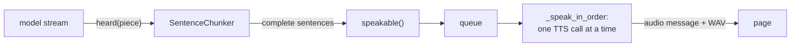

# 4. One turn

[`TurnPipeline.run`](../../gateway/src/sarjy_gateway/turn.py#L238) takes one clip of
speech, the visit's `Conversation` and a listener, and returns a `CompletedTurn`. In
between, it transcribes the speech, asks the model, and speaks the answer. This is where
time to first audio is won or lost. The pipeline has two modes, set by
`SARJY_PIPELINE_MODE`: `sentence`, the default, speaks each sentence as soon as the model
has written it ([D-76](../DECISIONS.md#d-76-sentence-streaming-every-written-sentence-spoken-in-order-tools-first), [D-77](../DECISIONS.md#d-77-the-page-plays-sentence-clips-back-to-back-sentence-mode-by-default)); `baseline` waits for the whole reply, and is kept so the two
can be compared (experiment 1).

This chapter follows a turn up to the model and back out as audio. What happens inside
the model's rounds, the tools and the prompt's content, is [chapter 5](05-model-and-tools.md).

## `run()`, step by step

1. **Name the turn.** A new `turn_id`, a UUIDv7 as 32 hex characters, and a
   [`Timeline`](../../gateway/src/sarjy_gateway/timeline.py#L14) on the monotonic clock.
   The first mark is `audio_received`.
2. **Start the prompt.** `asyncio.ensure_future` starts building the system prompt
   ([line 244](../../gateway/src/sarjy_gateway/turn.py#L244)) and does not wait for it.
3. **Transcribe.** [`_transcribe`](../../gateway/src/sarjy_gateway/turn.py#L267) calls
   STT. Then the `stt_done` mark, the `transcript` message to the page, and only then
   `await prompt`, which by now is usually done.
4. **Answer.** In sentence mode,
   [`_answer_aloud`](../../gateway/src/sarjy_gateway/turn.py#L295). In the baseline,
   [`_answer`](../../gateway/src/sarjy_gateway/turn.py#L279), then the whole reply to TTS.
5. **Remember.** [`conversation.remember`](../../gateway/src/sarjy_gateway/turn.py#L98)
   adds the turn to the visit's recent history. This only happens once the turn has
   succeeded, so a failed turn leaves the history as it was.
6. **Return** a [`CompletedTurn`](../../gateway/src/sarjy_gateway/turn.py#L113) with the
   transcript, the reply, the marks and the tool results, and log "turn completed" with
   the marks. [Chapter 3](03-visit.md) showed what the router does with it: send `marks`, then save.

## Speech to text

[`GroqSpeechToText.transcribe`](../../gateway/src/sarjy_gateway/stt.py#L48) uploads the
whole clip to Groq's `/openai/v1/audio/transcriptions` as a form, with
`whisper-large-v3-turbo`, `language=en`, temperature 0, and a short
[vocabulary prompt](../../gateway/src/sarjy_gateway/stt.py#L14) that spells the names
Whisper would otherwise mishear: Sarjy, Magic Experience, the emirates, AED, dirhams
([D-51](../DECISIONS.md#d-51-stt-groq-whisper-large-v3-turbo-one-clip-per-turn)).

Groq needs a file name whose extension matches the audio, and browsers record different
containers. [`container_of`](../../gateway/src/sarjy_gateway/stt.py#L87) reads the first
bytes: `1A 45 DF A3` is WebM (Chrome), `ftyp` at byte 4 is MP4 (Safari), then WAV and Ogg.
Anything else fails before any request is made.

The upload is one clip per turn, sent when the turn ends. Groq's endpoint takes a file and
doesn't stream, which suits push-to-talk, where the clip is complete at the release. The
page still sends the audio in 250 ms chunks while the traveller speaks, so by the release
most of it is already at the gateway. A spoken test question came back in about 0.4 s
([D-51](../DECISIONS.md#d-51-stt-groq-whisper-large-v3-turbo-one-clip-per-turn)).

Silence rarely gets this far. Whisper turns silence into words such as "Thank you.", so the
page cancels presses that are too short or too quiet before they are sent ([D-55](../DECISIONS.md#d-55-the-browser-drops-presses-with-no-speech-before-they-reach-whisper)).

## The prompt, built while STT runs

[`SystemPrompt.build`](../../gateway/src/sarjy_gateway/prompts.py#L142) needs SayTech's
catalogue context, which comes through a 5-minute cache. On a cache miss that is a call to
SayTech. Starting the build before transcription means that call overlaps STT instead of
following it, so a miss adds nothing to the wait ([D-62](../DECISIONS.md#d-62-prompt-v1-the-no-guessing-rule-first-defaults-in-code-context-during-stt)). If SayTech can't be reached at
all, the prompt is built without the catalogue and the turn goes ahead. The `finally` on
[line 250](../../gateway/src/sarjy_gateway/turn.py#L250) cancels the build if
transcription fails, so nothing is left running.

## Speaking while the model writes

[`_answer_aloud`](../../gateway/src/sarjy_gateway/turn.py#L295) creates a
[`SentenceSpeaker`](../../gateway/src/sarjy_gateway/turn.py#L161), runs the model's rounds
with it (`_converse`, [chapter 5](05-model-and-tools.md)), then waits for it to finish. If not a single sentence
was spoken, the turn fails with `llm_failed`. Otherwise the reply is the spoken sentences
joined together, sent as `reply` after the last clip, with the links of the tours it names.
So the reply the page shows, and the one the history keeps, is exactly what the traveller
heard.

### `SentenceSpeaker`

The speaker sits between the model's stream and TTS. It owns a `SentenceChunker`, a queue,
the list of sentences said so far, and a task started when the speaker is created,
[`_speak_in_order`](../../gateway/src/sarjy_gateway/turn.py#L204).

- [`heard(piece)`](../../gateway/src/sarjy_gateway/turn.py#L172) gets each piece of text as
  it streams in. The first piece of the turn sets `llm_first_token`. Each sentence the
  chunker completes goes to `_say`.
- [`round_ended()`](../../gateway/src/sarjy_gateway/turn.py#L179) flushes the chunker at
  the end of each model round, so text without a final full stop is queued for speech
  before any tool runs.
- `_say` cleans each sentence with `speakable()`, sets `first_sentence_ready` on the first
  one, and puts it on the queue.
- `_speak_in_order` takes sentences off the queue one at a time, synthesises each in the
  visit's voice, sets `tts_first_byte` on the first clip, and sends it to the page.
- [`finish()`](../../gateway/src/sarjy_gateway/turn.py#L183) puts `None` on the queue to
  end the loop, waits for the last clip to go, and returns the sentences.
- [`stop()`](../../gateway/src/sarjy_gateway/turn.py#L189) cancels the task after a
  failure elsewhere in the turn.

One TTS call at a time keeps the clips in order with no bookkeeping, and Kokoro on 8 vCPU
synthesises faster than it speaks, so the next clip is normally ready before the current
one ends ([D-76](../DECISIONS.md#d-76-sentence-streaming-every-written-sentence-spoken-in-order-tools-first)). If a TTS call fails, the task raises `TurnError("tts_failed")`, which
surfaces when `finish()` waits for it.

Text the model writes before calling a tool is spoken too, while the tool runs. The
prompt allows nothing, or one short sentence to the traveller about what Sarjy is
checking, such as "Let me check the weather in Abu Dhabi", and never the model's own
planning ([D-105](../DECISIONS.md#d-105-before-a-tool-one-short-sentence-to-the-traveller-never-the-plan)).
That sentence then counts as the first audio, which is what the traveller hears, so
time to first audio improves more than the answer itself does ([D-76](../DECISIONS.md#d-76-sentence-streaming-every-written-sentence-spoken-in-order-tools-first)).

### `SentenceChunker`

[`SentenceChunker`](../../gateway/src/sarjy_gateway/sentences.py#L20) turns text that
arrives in pieces into sentences TTS can speak one by one. The hard part is the full stop:
it only ends a sentence once the next character shows it isn't part of a number or a word.

- [`sentence_end`](../../gateway/src/sarjy_gateway/sentences.py#L50) finds where the first
  complete sentence ends. A line break after some text ends one. So does `.`, `!`, `?` or
  `…`, together with any closing quotes or brackets after it, but only when a space follows
  and the full stop isn't an abbreviation. If the ending is the last character received, it
  returns `None` and waits: "3." may become "3.5".
- [`is_abbreviation`](../../gateway/src/sarjy_gateway/sentences.py#L69) knows a short list,
  such as "Dr.", "e.g." and "Bros.", which is in a tour's name (Warner Bros. World), and
  treats initials such as "U.S." the same way.
- A sentence shorter than 12 characters joins the next
  ([`MIN_SENTENCE_CHARS`](../../gateway/src/sarjy_gateway/sentences.py#L6)): "Sure." alone
  would be a TTS call for half a second of audio, and Kokoro reads short fragments with
  odd intonation.
- [`flush`](../../gateway/src/sarjy_gateway/sentences.py#L35) returns whatever is left.
- [`speakable`](../../gateway/src/sarjy_gateway/sentences.py#L89) removes markdown and list
  markers the model sometimes writes despite the prompt. It is the one per-sentence step
  between the model and TTS, where a check of spoken facts would also go.

Sentences rather than words: a word is too short to sound natural on its own and would
cost a TTS call each. Sentences rather than the whole reply: TTS was 48% of the baseline's
time to first audio, and grew with the length of the reply ([D-76](../DECISIONS.md#d-76-sentence-streaming-every-written-sentence-spoken-in-order-tools-first)).

## The baseline

[`_answer`](../../gateway/src/sarjy_gateway/turn.py#L279) runs the same `_converse` with no
speaker and keeps only the last round's text.
[`_spoken`](../../gateway/src/sarjy_gateway/turn.py#L390) marks `llm_first_token` at that
round's first word, using a clock reading saved when the word arrived
([`Timeline.mark(at=...)`](../../gateway/src/sarjy_gateway/timeline.py#L23)), because only
at the end is it known which round was the spoken answer ([D-57](../DECISIONS.md#d-57-the-tool-loop-and-what-llm_first_token-means-with-tools)). Then `run()` marks
`first_sentence_ready`, sends `reply`, synthesises the whole reply in one call, marks
`tts_first_byte` and sends one clip.

The two modes measure `llm_first_token` differently. In the baseline it is the first word
of the answer after any tool rounds. In sentence mode it is the first word of any round,
since every round's words are spoken. [Chapter 8](08-latency.md) comes back to this.

## When something fails

Each stage turns its own failures into one [`TurnError`](../../gateway/src/sarjy_gateway/turn.py#L63)
with a code and the turn's id.

| Stage | Failure | Code |
| --- | --- | --- |
| STT | Groq answered 429 | `rate_limited` |
| STT | Network error, HTTP error, unexpected answer, unknown container, no key | `stt_failed` |
| STT | No words in the transcript | `no_speech` |
| Prompt | SayTech unreachable | none: the prompt goes without the catalogue |
| Model | 429 with no fallback left | `rate_limited` |
| Model | Any other failure, no words, or tools in the last round | `llm_failed` |
| TTS | Any failure | `tts_failed` |

A failed turn is not remembered and not saved. In sentence mode, clips that were already
sent have already played.

## How it is tested

[`test_turn.py`](../../gateway/tests/test_turn.py) builds pipelines with
[`pipeline_with`](../../gateway/tests/test_turn.py#L46): `FakeSpeechToText`, a scripted
`FakeChatModel`, `FakeTextToSpeech` and a `TickingClock`, with a `RecordingListener` that
keeps every event in order. Among its tests:
`test_streaming_speaks_each_sentence_as_it_is_written_and_sends_the_reply_last`,
`test_streaming_speaks_what_the_model_says_before_a_tool_while_it_runs`,
`test_marks_follow_the_turn_in_order_from_audio_received`, and
`test_a_failing_stage_raises_one_clear_code_and_leaves_history_alone`.

[`test_sentences.py`](../../gateway/tests/test_sentences.py) feeds the chunker text in
pieces: a sentence split across pieces, a decimal arriving in pieces ("3", ".", "5"),
abbreviations, Warner Bros. World, initials, an ellipsis, short fragments, a closing quote
and a line break. [`test_stt.py`](../../gateway/tests/test_stt.py) checks the upload's
fields, that a 429 is its own error, that no error message contains the key, and the
container check.
