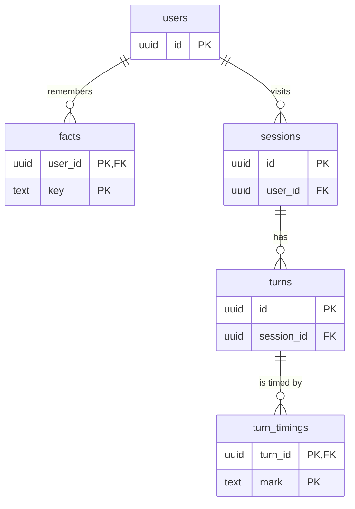

# 6. Memory and storage

Postgres holds everything that outlives a visit: who the user is, what Sarjy remembers
about them, every visit and turn, and every turn's timings. It is Cloud SQL for PostgreSQL
18 on the smallest tier ([D-64](../DECISIONS.md#d-64-postgres-18-on-the-smallest-cloud-sql-tier-reached-through-cloud-runs-socket)), reached with psycopg 3 and raw SQL, with no ORM, so every
query is visible and can be explained ([D-12](../DECISIONS.md#d-12-backend-python-fastapi-raw-sql)). Saving a turn never delays its reply; the
only writes a reply waits for are the memory tools', inside their tool round. If the
database is down, Sarjy still talks, and only memory, history and timings are lost.

## The schema

The five tables are in one file,
[`001_schema.sql`](../../gateway/src/sarjy_gateway/migrations/001_schema.sql) ([D-16](../DECISIONS.md#d-16-database-cloud-sql-for-postgresql-five-tables), [D-65](../DECISIONS.md#d-65-schema-migrations-at-startup-and-tests-on-a-real-postgres)).



| Table | Columns | Notes |
| --- | --- | --- |
| `users` | `id`, `created_at`, `last_seen_at` | One row per browser, keyed by the cookie's id |
| `facts` | `user_id`, `key`, `value`, `updated_at` | The primary key is `(user_id, key)`: one value per key, so saying a fact again replaces it |
| `sessions` | `id`, `user_id`, `started_at` | One row per visit |
| `turns` | `id`, `session_id`, `transcript`, `reply`, `tool_results`, `created_at` | One row per exchange, under the pipeline's own `turn_id`; `tool_results` is a `text[]` of what the tools returned |
| `turn_timings` | `turn_id`, `mark`, `at_ms` | One row per mark; the primary key is `(turn_id, mark)` |

Ids default to `uuidv7()`, which Postgres 18 has built in. Every foreign key is
`ON DELETE CASCADE`, and `sessions.user_id` and `turns.session_id` are indexed. A turn is
one row for the whole exchange, rather than one row per speaker, so its marks have one row
to belong to ([D-65](../DECISIONS.md#d-65-schema-migrations-at-startup-and-tests-on-a-real-postgres)). Mark names are checked by the typed Python models that write them,
not by a `CHECK` in the database. The tool results are kept so a later check could test
spoken prices against them.

## Migrations

[`MigrationRunner`](../../gateway/src/sarjy_gateway/migrate.py#L42) applies the numbered
SQL files that ship inside the gateway package, so the image carries its own schema ([D-65](../DECISIONS.md#d-65-schema-migrations-at-startup-and-tests-on-a-real-postgres)).
[`_apply_pending`](../../gateway/src/sarjy_gateway/migrate.py#L67):

1. creates `schema_migrations` if needed, in a transaction of its own, so a failing
   migration can't roll the record away with it;
2. in a second transaction, takes a Postgres advisory lock with a fixed number
   ([`MIGRATION_LOCK`](../../gateway/src/sarjy_gateway/migrate.py#L21)), so two instances
   starting together take turns;
3. reads which files are applied, runs each pending one in name order, and records it.

All pending files run in that one transaction, so a failing file leaves the schema as it
was. The schema file also sets `lock_timeout` to 5 s, so a migration never waits long for a
lock. The runner is called from the app's `lifespan` at start-up; a failure is logged and
voice carries on ([chapter 1](01-shape.md)). About forty lines replace a migration tool such as Alembic,
which would bring a dependency and its own concepts.

## The pool and its transactions

[`database_pool`](../../gateway/src/sarjy_gateway/database.py#L51) keeps at least one
connection open and grows to four, so a turn rarely waits for a new one. Two gateway instances then use at
most 8 of the smallest tier's connections. A query waits at most 5 seconds for a free
connection.

Every write follows the same pattern:

```python
async with self._pool.connection() as connection, connection.transaction():
    await connection.execute("INSERT ... ON CONFLICT ...", (user_id, key, value))
```

Writes run inside an explicit `transaction()`, which commits when the block ends and rolls
back if it raises; reads just borrow a connection. Values are always passed as parameters, never formatted into the SQL.
Rows are read into small dataclasses with psycopg's `class_row`, and every `SELECT` names
its columns. Any `psycopg.Error` or `PoolTimeout` becomes a
[`DatabaseUnavailableError`](../../gateway/src/sarjy_gateway/database.py#L19) with the
error's type in its message, the one database exception the rest of the gateway handles.
The migration runner has its own, `MigrationError`.

## Facts: `memory.py`

Memory is explicit: the model decides what is worth keeping and saves it through a tool
([D-15](../DECISIONS.md#d-15-memory-is-explicit-saved-through-tools)). [`PostgresFactStore`](../../gateway/src/sarjy_gateway/memory.py#L44) has four
methods:

| Method | SQL |
| --- | --- |
| [`facts`](../../gateway/src/sarjy_gateway/memory.py#L48) | `SELECT key, value FROM facts WHERE user_id = %s ORDER BY key` |
| [`remember`](../../gateway/src/sarjy_gateway/memory.py#L57) | `INSERT INTO facts ... ON CONFLICT (user_id, key) DO UPDATE SET value = excluded.value, updated_at = now()` |
| [`forget`](../../gateway/src/sarjy_gateway/memory.py#L69) | `DELETE FROM facts WHERE user_id = %s AND key = %s`, returning whether a row went |
| [`forget_all`](../../gateway/src/sarjy_gateway/memory.py#L79) | `DELETE FROM facts WHERE user_id = %s`, for "Forget me" |

The upsert is what makes "actually, my favourite colour is blue" work: the same key, a new
value, one row ([D-67](../DECISIONS.md#d-67-memory-facts-per-user-tools-per-visit-the-prompt-kept-current-in-memory)). Keys are normalised first by
[`normalise_key`](../../gateway/src/sarjy_gateway/memory.py#L117): lower case, with
anything that isn't a letter or digit turned into one underscore, so "Favourite Colour"
and "favourite-colour" are the same fact.

The two tools are created for each visit, in `_serve`, with that visit's user, its
`Conversation` and its socket listener ([chapter 3](03-visit.md)). So one user's tool can't touch another
user's facts by construction, and no tool needs an extra argument for who is talking
([D-67](../DECISIONS.md#d-67-memory-facts-per-user-tools-per-visit-the-prompt-kept-current-in-memory)).

- [`RememberFactTool.run`](../../gateway/src/sarjy_gateway/memory.py#L162) validates the
  arguments (a key of up to 60 characters, a value of up to 200), normalises the key,
  saves the fact, updates the visit's copy of the facts, sends the page a new `memory`
  list, and returns `{"saved": key, "value": value}` to the model.
- [`ForgetFactTool.run`](../../gateway/src/sarjy_gateway/memory.py#L189) deletes the fact,
  removes it from the visit's copy and the page's list if it was there, and tells the
  model if nothing was saved under that key.

The visit's copy matters. Facts are read from Postgres once, when the visit opens. After
that the tools keep `conversation.facts` current, and every turn's prompt is built from it,
so a fact saved in one turn is in the next turn's prompt without a query ([D-67](../DECISIONS.md#d-67-memory-facts-per-user-tools-per-visit-the-prompt-kept-current-in-memory)). The
voice the traveller picked is stored the same way, as the `voice` fact ([D-90](../DECISIONS.md#d-90-tour-links-beside-the-reply-a-remembered-voice-and-reconnecting)); the page
leaves it out of its memory panel ([D-82](../DECISIONS.md#d-82-the-voice-picker-sits-under-the-orb-the-voice-fact-stays-out-of-memory)).

## Visits, turns and timings: `conversation_store.py`

[`PostgresConversationStore`](../../gateway/src/sarjy_gateway/conversation_store.py#L101)
does the rest.

- [`start_session`](../../gateway/src/sarjy_gateway/conversation_store.py#L107) runs two
  statements in one transaction: it upserts the user
  (`ON CONFLICT (id) DO UPDATE SET last_seen_at = now()`) and inserts a session,
  `RETURNING id`. A returning browser keeps its user; every visit is a new session ([D-66](../DECISIONS.md#d-66-identity-by-cookie-one-session-per-visit-turns-saved-after-they-are-spoken)).
- [`save_turn`](../../gateway/src/sarjy_gateway/conversation_store.py#L124) inserts the
  turn with `ON CONFLICT (id) DO NOTHING`, so saving the same turn twice can't duplicate it.
- [`save_marks`](../../gateway/src/sarjy_gateway/conversation_store.py#L158) inserts each
  mark with `INSERT ... SELECT id, ... FROM turns WHERE id = %s AND session_id = %s`. A mark
  only lands for a turn of this visit, so a page can't write timings into another visit's
  turn, and `ON CONFLICT (turn_id, mark) DO NOTHING` keeps the first value ([D-74](../DECISIONS.md#d-74-timings-in-postgres-for-every-turn-runs-as-json-lines-files)). The
  gateway's five marks and the browser's two arrive separately and end up side by side.
- [`earlier_visits`](../../gateway/src/sarjy_gateway/conversation_store.py#L182) is one
  query: the user's 3 most recent other sessions that have at least one turn, joined with
  their turns, newest visit first and each visit's turns in order. `IS DISTINCT FROM`
  handles a current session of `NULL`. [`group_visits`](../../gateway/src/sarjy_gateway/conversation_store.py#L263)
  keeps each visit's last 10 exchanges ([D-92](../DECISIONS.md#d-92-earlier-visits-sent-with-the-visit-replays-re-synthesised)).
- [`reply_of`](../../gateway/src/sarjy_gateway/conversation_store.py#L203) joins the turn to
  its session and checks the user, so a page can only replay its own user's turns.

`user`, `turns` and `marks` read rows back. Only the tests use them.

## When something fails

Every caller catches `DatabaseUnavailableError` and carries on without the database. Most
log a warning; the memory tools pass the failure to the model instead:

| Feature | Without the database |
| --- | --- |
| A visit opens | No session row: the visit's turns are spoken but not saved |
| Facts | The visit starts knowing nothing; `remember_fact` tells the model "Memory isn't available right now, so nothing was saved." |
| Earlier visits | None shown |
| "Forget me" | `forget_failed` |
| Picking a voice | Works for this visit, not remembered for the next |
| Replay | `replay_failed` |
| `GET /ready` | 503 with the reason |

## How it is tested

The database tests run on a real Postgres 18, never a fake, because upserts, conflicts and
constraints only behave as in production on Postgres itself ([D-65](../DECISIONS.md#d-65-schema-migrations-at-startup-and-tests-on-a-real-postgres)). Locally that is the
`sarjy_test` database in the Compose container, created by
[`infra/local/postgres-init.sql`](../../infra/local/postgres-init.sql); in CI, a Postgres
service in [`tests.yml`](../../.github/workflows/tests.yml#L24). Each test opens its own
pool, applies the schema through `MigrationRunner` and uses fresh user ids, so tests don't
see each other's rows.

- [`test_conversation_store.py`](../../gateway/tests/test_conversation_store.py): a new user
  with their first session, a returning user, marks kept only for a turn of the same
  session, earlier visits newest first.
- [`test_memory.py`](../../gateway/tests/test_memory.py): key normalisation, saying a fact
  again replaces it, "Forget me" deletes only that user's facts, a fact saved in one turn
  is in the next turn's prompt, and the model's message without the database.
- [`test_migrate.py`](../../gateway/tests/test_migrate.py): migrations apply once, a failing
  one leaves the record as it was, and an unreachable database is a `MigrationError`.
