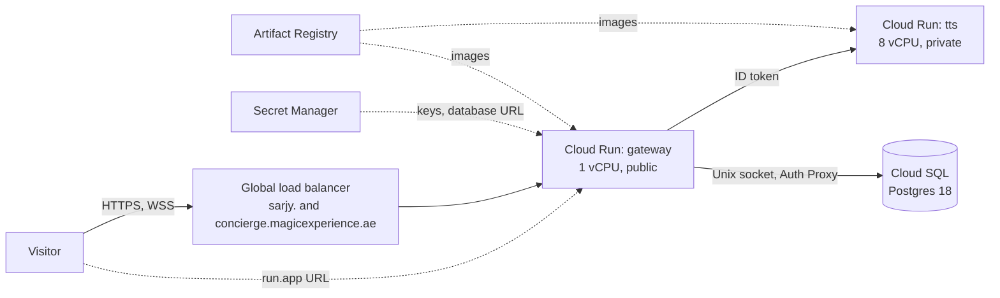

# 10. Shipping it

Sarjy runs on Google Cloud in `me-central1`, Doha, the region closest to Gulf visitors
([D-44](../DECISIONS.md#d-44-region-me-central1-doha), [D-98](../DECISIONS.md#d-98-the-services-stay-in-doha-me-central1-for-the-submission)). Terraform describes the cloud resources, GitHub Actions deploys every merge
to `main` without a stored key, and images built from the same Dockerfiles run on a laptop
through Compose ([D-22](../DECISIONS.md#d-22-hosting-gcp-cloud-run-terraform-github-actions), [D-35](../DECISIONS.md#d-35-deploy-through-ci-from-day-one)). A few things are made by hand: Terraform's state bucket, the
budget alert, the database user, the secrets' values and the domains' DNS records. This chapter walks through the infrastructure, the deploy path, the local
stack and the code standards that guard every commit.

## The infrastructure: `infra/`

Terraform keeps its state in a Cloud Storage bucket created by hand before the first
`terraform init` ([`versions.tf`](../../infra/versions.tf#L12)). It is planned and applied
by hand, after review; CI never runs it.

### Cloud Run: [`services.tf`](../../infra/services.tf)

| | Gateway | TTS |
| --- | --- | --- |
| Size | 1 vCPU, 512 MiB, start-up CPU boost | 8 vCPU, 4 GiB, start-up CPU boost ([D-70](../DECISIONS.md#d-70-tts-on-8-vcpu-still-scaling-to-zero)) |
| Instances | 0 or 1 kept warm, at most 2 ([D-72](../DECISIONS.md#d-72-turn-limits-in-memory-per-user-and-per-ip-counted-per-instance), [D-78](../DECISIONS.md#d-78-cold-starts-tts-woken-when-a-visit-opens-warm-instances-a-setting)) | 0 or 1 kept warm, at most 1, up to 4 requests at once |
| Access | Public: `allUsers` may invoke it | Private: only the gateway's service account may invoke it ([D-45](../DECISIONS.md#d-45-tts-is-private-the-gateway-calls-it-with-its-own-identity)) |
| Request timeout | 3600 s, because a visit's WebSocket is one long request | the default |
| Settings | TTS URL and `id_token` auth, the keys and the database URL from Secret Manager, `SARJY_LLM_PRIMARY`, `SARJY_PIPELINE_MODE` | `SARJY_THREADS=8` |

Each service runs as its own service account
([`identities.tf`](../../infra/identities.tf)), so each holds only the permissions it
needs. Both services start from Google's sample image, and Terraform ignores the image
afterwards ([line 132](../../infra/services.tf#L132)): CI deploys images, and Terraform
owns everything else. The warm instances and the first model are variables
([`variables.tf`](../../infra/variables.tf)), so the review-week settings are one value to
set and to undo ([D-78](../DECISIONS.md#d-78-cold-starts-tts-woken-when-a-visit-opens-warm-instances-a-setting)).

Cloud Run reads each secret when an instance starts, from version `latest`, so a key never
passes through Terraform, and a rotated key is picked up by the next revision. The same
Groq key serves speech to text and the fallback model.

### Cloud SQL: [`database.tf`](../../infra/database.tf)

One PostgreSQL 18 instance on `db-f1-micro`, the smallest, shared-core tier, which only
the Enterprise edition offers. It is zonal, with 10 GB, deletion protection and no backups,
since it holds demo data ([D-64](../DECISIONS.md#d-64-postgres-18-on-the-smallest-cloud-sql-tier-reached-through-cloud-runs-socket)). The gateway reaches it through Cloud Run's built-in Cloud
SQL connection: a Unix socket under `/cloudsql`, through the Cloud SQL Auth Proxy,
authorised by the gateway's identity (`roles/cloudsql.client`). The instance has a public
address but no authorised networks, and accepts only encrypted connections, so nothing
else can connect. The database user and the `database-url` secret's value are created by
hand, so the password never sits in Terraform's state.

### Artifact Registry: [`registry.tf`](../../infra/registry.tf)

One Docker repository, `sarjy`. A clean-up policy keeps the five newest versions of each
image, enough to roll back a few deploys, and deletes the rest ([D-73](../DECISIONS.md#d-73-tts-images-tagged-by-what-they-are-built-from-five-versions-kept)).

### Secret Manager: [`secrets.tf`](../../infra/secrets.tf)

Terraform manages the secrets `groq-api-key`, `anthropic-api-key` and `database-url`
(the last in `database.tf`), each stored only in the region, and grants the gateway's
account access; `anthropic-api-key` was created by hand on 9 Oct and then imported. Their values are
added by hand with `gcloud secrets versions add`, so they never appear in Terraform state.

### Keyless CI: [`ci.tf`](../../infra/ci.tf)

GitHub Actions deploys through Workload Identity Federation ([D-46](../DECISIONS.md#d-46-ci-deploys-through-workload-identity-federation-and-one-script)). A workload identity
pool trusts GitHub's OIDC tokens, and its provider accepts only a token whose
`repository_id` is this repository's numeric id and whose `ref` is `refs/heads/main`
([line 21](../../infra/ci.tf#L21)). The numeric id, not the name, means a repository later
created under the same name can't deploy; a fork or another branch can't either. Such a
token can act as the `sarjy-deployer` service account, which may:

- push images to the `sarjy` repository;
- update the `gateway` and `tts` services, granted on those two services rather than the
  whole project;
- act as their runtime accounts, which deploying a revision needs.

No service-account key exists anywhere.

### The domain: [`domain.tf`](../../infra/domain.tf)

Cloud Run can't map a custom domain in `me-central1`, so a global external Application
Load Balancer sits in front of the same gateway service ([D-44](../DECISIONS.md#d-44-region-me-central1-doha), [D-101](../DECISIONS.md#d-101-magic-experiences-own-domains-through-a-global-load-balancer)):

1. a static global IP address, which the A records of `sarjy.magicexperience.ae` and
   `concierge.magicexperience.ae` point to, at Etisalat;
2. a serverless network endpoint group that points at the gateway service, whichever
   revision is serving;
3. a backend service with no timeout of its own, so a WebSocket keeps Cloud Run's 3600 s;
4. one Google-managed certificate per domain, so a domain whose DNS record is late holds up
   only itself;
5. an HTTPS proxy and a forwarding rule on port 443, and a second URL map that redirects
   port 80 to HTTPS, where the microphone is allowed.

The `run.app` URL keeps working alongside it.

## Deploying: the workflow and the script

[`deploy.yml`](../../.github/workflows/deploy.yml) runs on every push to `main`. Branch
protection means `main` only receives commits whose pull request passed every check
([D-40](../DECISIONS.md#d-40-rebase-merge-only-and-a-protected-main)). It asks GitHub for an OIDC token (`id-token: write`), exchanges it for the
deployer's credentials, and runs [`scripts/deploy.sh`](../../scripts/deploy.sh) once per
service, as a matrix of `gateway` and `tts`. A running deploy is never cancelled: the next
one waits for it, so none stops halfway. Each action the workflow uses is pinned to a commit.

`deploy.sh` changes only the image:

1. **Tag.** The gateway's image is tagged with its commit. The TTS image is 420 MB and
   rarely changes, so its tag is `inputs-` and a fingerprint of the files it is built
   from: a hash of the git listing of `tts/`, the workspace's `pyproject.toml`, `uv.lock`,
   `gateway/pyproject.toml` and `.dockerignore` ([line 20](../../scripts/deploy.sh#L20)).
   Any commit that leaves those alone gives the same tag ([D-73](../DECISIONS.md#d-73-tts-images-tagged-by-what-they-are-built-from-five-versions-kept)).
2. **Skip if done.** If the service already runs that image and its newest revision is
   ready, there is nothing to do.
3. **Skip the build if possible.** If the registry already has the image, it is deployed
   without a rebuild.
4. **Build, push, update.** Otherwise `docker build` and `docker push`, then
   `gcloud run services update --image`, which rolls out a new revision.

A deploy drops the visits in progress: Cloud Run retires the old gateway revision within
about a minute and closes its sockets. The page reconnects, but a question asked at that
moment is lost, so merges wait for quiet times ([D-102](../DECISIONS.md#d-102-a-deploy-drops-the-visits-in-progress-so-merges-wait-for-quiet-times)).

### The images

Both Dockerfiles build from the repository root in stages, from base images pinned by
digest, and run as a non-root user.
[`gateway/Dockerfile`](../../gateway/Dockerfile) builds the page with Node 24, installs only
the gateway's locked dependencies with uv (dependencies first, so a code change reuses that
layer), then copies the virtual environment and the built page into a slim Python 3.14
image with `SARJY_FRONTEND_DIST` set. [`tts/Dockerfile`](../../tts/Dockerfile) adds a stage
that downloads and checks the model files ([chapter 7](07-voice.md)).

## The whole stack locally: `compose.yaml`

[`compose.yaml`](../../compose.yaml) builds the same Dockerfiles and runs them on one
machine, with `postgres:18` standing in for Cloud SQL. With the keys in
`.env`, `docker compose up --build` starts:

- **`db`:** Postgres 18 on `127.0.0.1:5432`, with its data in a volume and a `sarjy_test`
  database created on first start for the tests;
- **`tts`:** built from `tts/Dockerfile`, healthy once `/health` answers;
- **`gateway`:** built from `gateway/Dockerfile`, on `127.0.0.1:8080`, with the TTS URL and
  database URL pointing at the other two, Claude first unless `.env` says otherwise, and
  `SARJY_COOKIE_SECURE=false` for plain-HTTP localhost. It starts once the database and TTS
  are healthy.

`docker compose up -d --wait db` starts the database alone, for development.

## The code standards

The repository adopted Sarj's public code and repository standards before any feature, and
they run on every commit ([D-26](../DECISIONS.md#d-26-sarjs-code-standards-from-the-first-commit)). `code-standards setup` manages
[`.sarj-standards.toml`](../../.sarj-standards.toml), the tool configurations beside it
(ruff, basedpyright in strict mode, ESLint, markdownlint, yamllint and others) and the
hooks. Nothing bypasses them, and no exception has been approved.

| Where | What runs |
| --- | --- |
| Before each commit | [`.pre-commit-config.yaml`](../../.pre-commit-config.yaml): `code-standards check --staged` on the staged files, then the managed commit-message check ([D-39](../DECISIONS.md#d-39-pre-commit-runs-the-standards-hooks)) |
| Every pull request and push to `main` | [`standards.yml`](../../.github/workflows/standards.yml), generated: the full `code-standards check` |
| Every pull request | [`commit-policy.yml`](../../.github/workflows/commit-policy.yml), generated: repo-standards' check of the pull request's commits |
| Every pull request and push to `main` | [`tests.yml`](../../.github/workflows/tests.yml), written by hand because the generated workflow doesn't run tests: `uv run pytest` against a Postgres 18 service, and the frontend's `npm run build` |

`main` is protected: it takes changes only through pull requests whose Standards, Commit
policy and Tests checks passed, keeps a linear history, takes rebase merges only, and
applies the same rules to admins ([D-40](../DECISIONS.md#d-40-rebase-merge-only-and-a-protected-main)).

## When something fails

- **A check fails.** The pull request can't merge, so nothing deploys.
- **A deploy fails.** The job fails and the next push deploys again. The script's checks
  make a re-run safe: an image already deployed is skipped, and one already built isn't
  rebuilt. On 9 Oct a TTS revision couldn't start because two 8-vCPU instances per
  revision exceeded the region's CPU quota during a rollout, which is why TTS is capped at
  one instance ([D-72](../DECISIONS.md#d-72-turn-limits-in-memory-per-user-and-per-ip-counted-per-instance)).
- **A setting is unset.** The gateway starts with the matching `Missing*` stand-in
  ([chapter 1](01-shape.md)), and `/ready` says so for the database.

## How it is checked

Terraform changes are checked by hand with `terraform fmt -check` and `terraform validate`,
and every change goes through a reviewed `terraform plan` before `terraform apply`, which
never runs without Ahmed's approval (`AGENTS.md` lists the commands). The standards check
covers the shell scripts with ShellCheck and the YAML files with yamllint, on every commit
like the code. The rest of the book
covers the tests these workflows run.
